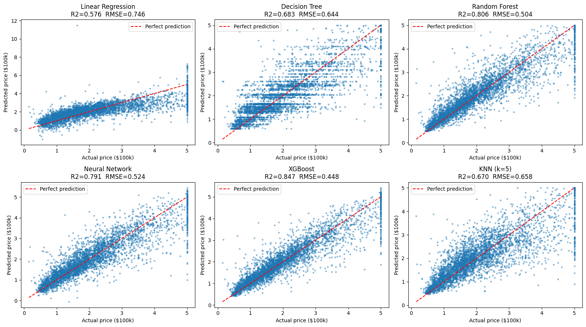
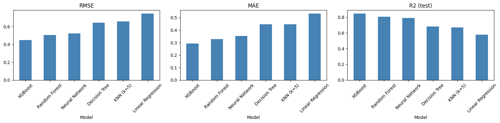

# Comparative Implementation of Machine Learning Regression Algorithms

**Name:** Dua e Zainab
**Registration No.:** FA34-BAI-027
**Problem:** House price prediction
**Dataset:** California Housing (scikit-learn), 20,640 records, 8 input features, target = median house value (in units of $100,000)
**Algorithms:** Linear Regression, Decision Tree, Random Forest, Neural Network, XGBoost, KNN

---

# PART A: HANDWRITTEN IMPLEMENTATION

## Sample data (used for all six hand calculations)

| House | Area x (100 sqft) | Price y (lakh) |
|---|---|---|
| 1 | 8 | 40 |
| 2 | 10 | 50 |
| 3 | 12 | 55 |
| 4 | 15 | 70 |
| 5 | 20 | 90 |

**Query house:** x = 14 (predict its price). Mean x̄ = 13, mean ȳ = 61.

---

## 1. Linear Regression

**Working procedure:** Fit the straight line ŷ = b0 + b1·x that minimizes the sum of squared errors (Ordinary Least Squares).

**Equations:**
- b1 = Σ(xi − x̄)(yi − ȳ) / Σ(xi − x̄)²
- b0 = ȳ − b1·x̄
- For many features: β = (XᵀX)⁻¹ Xᵀ y

**Calculation:**

| x | y | x − x̄ | y − ȳ | (x − x̄)(y − ȳ) | (x − x̄)² |
|---|---|---|---|---|---|
| 8 | 40 | −5 | −21 | 105 | 25 |
| 10 | 50 | −3 | −11 | 33 | 9 |
| 12 | 55 | −1 | −6 | 6 | 1 |
| 15 | 70 | 2 | 9 | 18 | 4 |
| 20 | 90 | 7 | 29 | 203 | 49 |
| | | | **Sum** | **365** | **88** |

- b1 = 365 / 88 = 4.148
- b0 = 61 − 4.148 × 13 = 7.08
- Model: **ŷ = 7.08 + 4.148x**
- Prediction at x = 14: 7.08 + 4.148 × 14 = **65.15 lakh**

---

## 2. Decision Tree Regression

**Working procedure:** Try every split threshold (midpoints between sorted x values). Choose the split with the smallest total SSE of the two child nodes. The prediction of a leaf is the mean of the y values in it. Repeat recursively.

**Equations:**
- SSE(node) = Σ(yi − ȳnode)²
- Best split = argmin [SSE(left) + SSE(right)]
- Leaf prediction = mean(y in leaf)

**Calculation (root SSE = 1520):**

| Threshold | Left y (mean) | SSE left | Right y (mean) | SSE right | Total SSE |
|---|---|---|---|---|---|
| x ≤ 9 | 40 (40) | 0 | 50, 55, 70, 90 (66.25) | 968.75 | 968.75 |
| x ≤ 11 | 40, 50 (45) | 50 | 55, 70, 90 (71.67) | 616.67 | 666.67 |
| **x ≤ 13.5** | 40, 50, 55 (48.33) | 116.67 | 70, 90 (80) | 200 | **316.67 (best)** |
| x ≤ 17.5 | 40, 50, 55, 70 (53.75) | 468.75 | 90 (90) | 0 | 468.75 |

- Root split: **x ≤ 13.5**. The query x = 14 goes to the right node {70, 90}.
- Split the right node at x ≤ 17.5 into leaves {70} and {90}.
- x = 14 ≤ 17.5, so **prediction = 70 lakh** (a depth-1 stump would give 80).

---

## 3. Random Forest Regression

**Working procedure:** Build T trees, each on a bootstrap sample (random sampling with replacement). Average the predictions of all trees.

**Equation:** ŷ = (1/T) Σ treeₜ(x)

**Calculation (T = 3, fully grown trees, one feature so no feature sub-sampling):**

| Tree | Bootstrap sample (x : y) | Leaf containing x = 14 | Prediction |
|---|---|---|---|
| 1 | 8:40, 12:55, 15:70, 15:70, 20:90 | 14 lies between 12 and 15 (threshold 13.5), so it goes with 15 | 70 |
| 2 | 8:40, 10:50, 10:50, 12:55, 20:90 | 14 lies between 12 and 20 (threshold 16), so it goes with 12 | 55 |
| 3 | 10:50, 12:55, 15:70, 20:90, 20:90 | 14 lies between 12 and 15 (threshold 13.5), so it goes with 15 | 70 |

**ŷ = (70 + 55 + 70) / 3 = 65.0 lakh**

---

## 4. Neural Network Regression

**Working procedure:** Forward pass, compute the loss, backpropagate the gradients, update the weights with gradient descent.

**Setup:** Architecture 1 input, 2 hidden neurons (ReLU), 1 linear output. Min-max scaling: x' = (x − 8)/12 and y' = (y − 40)/50. Training sample: house 3, x = 12, so x' = 0.3333 and target y' = (55 − 40)/50 = 0.30. Learning rate η = 0.1. Loss L = ½(ŷ − y)².

Initial weights: w = [0.5, −0.4], b1 = [0.1, 0.2], v = [0.6, 0.3], b2 = 0.

**Equations:**
- zj = wj·x' + b1j, aj = ReLU(zj)
- ŷ = Σ vj·aj + b2
- e = ŷ − y
- ∂L/∂vj = e·aj, ∂L/∂b2 = e
- δj = e·vj·ReLU'(zj), ∂L/∂wj = δj·x', ∂L/∂b1j = δj
- Update: θ ← θ − η·∂L/∂θ

**Forward pass:**
- z1 = 0.5(0.3333) + 0.1 = 0.2667
- z2 = −0.4(0.3333) + 0.2 = 0.0667
- a = [0.2667, 0.0667]
- ŷ = 0.6(0.2667) + 0.3(0.0667) + 0 = **0.18**
- e = 0.18 − 0.30 = −0.12, L = ½(0.12)² = **0.0072**

**Backward pass:**
- ∂L/∂v = [−0.12 × 0.2667, −0.12 × 0.0667] = [−0.032, −0.008]
- ∂L/∂b2 = −0.12
- δ1 = −0.12 × 0.6 = −0.072, δ2 = −0.12 × 0.3 = −0.036
- ∂L/∂w = [−0.072 × 0.3333, −0.036 × 0.3333] = [−0.024, −0.012]
- ∂L/∂b1 = [−0.072, −0.036]

**Weight update (η = 0.1):**
- v = [0.6032, 0.3008], b2 = 0.012
- w = [0.5024, −0.3988], b1 = [0.1072, 0.2036]

**Forward pass after update:**
- z1 = 0.2747, z2 = 0.0707
- ŷ = 0.6032(0.2747) + 0.3008(0.0707) + 0.012 = **0.1989**
- New loss = **0.0051** (reduced from 0.0072)

Repeating this over all samples for many epochs trains the network. Training the full network on this sample gives a prediction close to the linear trend (about 65 lakh at x = 14).

---

## 5. XGBoost Regression

**Working procedure:** Start from a base prediction. Add trees one after another, where each tree is fitted to the gradients (errors) of the current model. Splits are chosen using a regularized gain.

**Equations (squared-error loss: gi = ŷi − yi, hi = 1):**
- Gain = ½ [ GL²/(HL + λ) + GR²/(HR + λ) − (GL + GR)²/(HL + HR + λ) ] − γ
- Leaf weight w* = −G / (H + λ)
- Update: ŷ_new = ŷ_old + η · w*

**Settings:** base prediction = 61 (mean), λ = 1, γ = 0, η = 0.5.

**Round 1:** gradients g = ŷ − y = [21, 11, 6, −9, −29]. Root G = 0, so the third gain term is 0.

| Split | GL, HL | GR, HR | Gain |
|---|---|---|---|
| x ≤ 9 | 21, 1 | −21, 4 | ½(220.5 + 88.2) = 154.35 |
| x ≤ 11 | 32, 2 | −32, 3 | ½(341.33 + 256) = 298.67 |
| **x ≤ 13.5** | 38, 3 | −38, 2 | ½(361 + 481.33) = **421.17 (best)** |
| x ≤ 17.5 | 29, 4 | −29, 1 | ½(168.2 + 420.5) = 294.35 |

- Left leaf: w = −38 / (3 + 1) = −9.5, new prediction 61 + 0.5(−9.5) = **56.25**
- Right leaf: w = 38 / (2 + 1) = 12.67, new prediction 61 + 0.5(12.67) = **67.33**
- Query x = 14 falls in the right leaf, so **ŷ after round 1 = 67.33 lakh**

Round 2 repeats the same steps on the new gradients, so the predictions move further toward the true values.

---

## 6. K-Nearest Neighbors Regression (k = 3)

**Working procedure:** Compute the distance from the query to every training point, take the k nearest, and average their target values.

**Equations:**
- d(x, xi) = |x − xi| (Euclidean distance in one dimension; for many features d = √Σ(xj − xij)² after scaling)
- ŷ = (1/k) Σ yi over the k nearest neighbors

**Calculation (query x = 14):**

| House | x | Distance | Rank |
|---|---|---|---|
| 4 | 15 | 1 | 1 |
| 3 | 12 | 2 | 2 |
| 2 | 10 | 4 | 3 |
| 1 | 8 | 6 | 4 |
| 5 | 20 | 6 | 5 |

ŷ = (70 + 55 + 50) / 3 = **58.33 lakh**

---

## Summary of handwritten predictions (query x = 14)

| Model | Prediction (lakh) |
|---|---|
| Linear Regression | 65.15 |
| Decision Tree | 70.00 |
| Random Forest (3 trees) | 65.00 |
| Neural Network | about 65 (after training) |
| XGBoost (1 round) | 67.33 |
| KNN (k = 3) | 58.33 |

The Python check in the notebook (Section 10) reproduces the Linear Regression (b0 = 7.08, b1 = 4.148, prediction 65.15), Decision Tree (70.0) and KNN (58.33) results exactly.

---

# PART B: PYTHON IMPLEMENTATION

**Libraries:** NumPy, pandas, matplotlib, scikit-learn, XGBoost (code in `regression_comparison.ipynb`).

## 1. Dataset

California Housing: 20,640 samples, 8 input features and 1 target.

| Feature | Description |
|---|---|
| MedInc | Median income in the block group |
| HouseAge | Median house age |
| AveRooms | Average number of rooms per household |
| AveBedrms | Average number of bedrooms per household |
| Population | Block group population |
| AveOccup | Average household occupancy |
| Latitude | Block group latitude |
| Longitude | Block group longitude |
| **MedHouseVal (target)** | Median house value in $100,000 |

## 2. Preprocessing

- Checked for missing values: **none** in any column.
- Checked for duplicate rows: **0** duplicates.
- Separated the features (X) from the target (y = MedHouseVal).
- Train/test split: **80:20** with `random_state=42`, giving **16,512 training** and **4,128 testing** samples. The same split was used for all six models.
- Feature scaling with `StandardScaler` (fitted on the training data only, to avoid data leakage) for Linear Regression, Neural Network and KNN, because they are sensitive to feature scale. Decision Tree, Random Forest and XGBoost do not need scaling.

## 3. Model configurations

| Model | Configuration |
|---|---|
| Linear Regression | StandardScaler + LinearRegression |
| Decision Tree | max_depth = 8, min_samples_leaf = 10 |
| Random Forest | n_estimators = 200 |
| Neural Network | StandardScaler + MLPRegressor, hidden layers (64, 32), ReLU, Adam, early stopping, max_iter = 500 |
| XGBoost | n_estimators = 400, learning_rate = 0.05, max_depth = 6, subsample = 0.8, colsample_bytree = 0.8 |
| KNN | StandardScaler + KNeighborsRegressor, k = 5 |

## 4. Evaluation metrics

- MAE = (1/n) Σ |yi − ŷi|
- MSE = (1/n) Σ (yi − ŷi)²
- RMSE = √MSE
- R² = 1 − SSres / SStot

---

# PART C: RESULTS

## Comparative performance table (test set, sorted by R²)

| Model | MAE | MSE | RMSE | R² (test) | R² (train) |
|---|---|---|---|---|---|
| **XGBoost** | **0.2935** | **0.2005** | **0.4478** | **0.8470** | 0.9318 |
| Random Forest | 0.3268 | 0.2540 | 0.5040 | 0.8062 | 0.9742 |
| Neural Network | 0.3533 | 0.2745 | 0.5239 | 0.7905 | 0.8156 |
| Decision Tree | 0.4467 | 0.4149 | 0.6441 | 0.6834 | 0.7516 |
| KNN (k = 5) | 0.4462 | 0.4324 | 0.6576 | 0.6700 | 0.7969 |
| Linear Regression | 0.5332 | 0.5559 | 0.7456 | 0.5758 | 0.6126 |

Since the target is in units of $100,000, the best model (XGBoost) has an average absolute error of about $29,350 (MAE) and an RMSE of about $44,780.

## Actual vs predicted values

Points close to the red dashed line (perfect prediction) are accurate. XGBoost and Random Forest show the tightest clustering around the line. Linear Regression shows the widest scatter and clearly underestimates high-priced houses. The Decision Tree shows horizontal bands because it predicts a constant value per leaf.

## Metric comparison

## Sample of test predictions (first 10 test rows)

| Actual | Linear Reg. | Decision Tree | Random Forest | Neural Net | XGBoost | KNN |
|---|---|---|---|---|---|---|
| 0.477 | 0.719 | 0.688 | 0.494 | 0.550 | 0.508 | 0.499 |
| 0.458 | 1.764 | 0.805 | 0.736 | 1.219 | 1.027 | 0.765 |
| 5.000 | 2.710 | 4.107 | 4.877 | 5.029 | 5.114 | 4.750 |
| 2.186 | 2.839 | 2.389 | 2.550 | 2.631 | 2.395 | 2.877 |
| 2.780 | 2.605 | 1.522 | 2.258 | 2.599 | 2.476 | 2.726 |
| 1.587 | 2.012 | 1.910 | 1.651 | 1.544 | 1.674 | 1.779 |
| 1.982 | 2.646 | 2.043 | 2.393 | 2.485 | 2.331 | 2.718 |
| 1.575 | 2.169 | 1.634 | 1.664 | 1.548 | 1.625 | 1.925 |
| 3.400 | 2.741 | 2.612 | 2.681 | 2.394 | 2.982 | 2.031 |
| 4.466 | 3.916 | 4.983 | 4.887 | 4.472 | 4.799 | 4.956 |

---

# PART D: DISCUSSION

## Strengths and limitations of each algorithm

### Linear Regression
- **Strengths:** Very fast, simple, no hyperparameter tuning, and the coefficients are easy to interpret.
- **Limitations:** Assumes a linear relationship between features and price, so it cannot capture non-linear patterns or interactions (such as location combined with income). Sensitive to outliers.
- **Observed result:** Weakest model (R² = 0.5758, RMSE = 0.7456). Its train R² (0.6126) is also low, which shows **underfitting**: the model is too simple for this data.

### Decision Tree
- **Strengths:** Easy to interpret and visualize, handles non-linear relationships, needs no feature scaling.
- **Limitations:** Prone to overfitting, unstable (small changes in data can change the tree), and gives piecewise-constant predictions.
- **Observed result:** R² = 0.6834, better than Linear Regression, but far below the ensembles. Limiting depth to 8 kept the train/test gap small (0.7516 vs 0.6834), at the cost of accuracy.

### Random Forest
- **Strengths:** Averaging many trees reduces variance, robust to noise and outliers, gives feature importance, requires little tuning.
- **Limitations:** Slower and heavier than a single tree, less interpretable, cannot extrapolate beyond the range of training targets.
- **Observed result:** Second best (R² = 0.8062). It shows the largest overfitting gap (train 0.9742 vs test 0.8062), meaning it memorizes the training data more than XGBoost does.

### Neural Network
- **Strengths:** Can model complex non-linear relationships and interactions, flexible architecture.
- **Limitations:** Needs feature scaling, sensitive to hyperparameters, behaves as a black box, and usually needs more data to excel.
- **Observed result:** Third (R² = 0.7905). It generalizes very well (train 0.8156 vs test 0.7905, smallest gap), but it did not match the tree ensembles on this tabular dataset. More tuning (more layers or neurons, regularization) might improve it.

### XGBoost
- **Strengths:** Sequential boosting corrects previous errors, built-in regularization (λ, γ, subsampling), handles non-linearity and feature interactions, typically the top performer on tabular data.
- **Limitations:** Many hyperparameters to tune, sequential training is slower than simple models, less interpretable, and can overfit if poorly tuned.
- **Observed result:** Best model on every metric (lowest MAE, MSE and RMSE, highest R²). Its train/test gap (0.9318 vs 0.8470) is smaller than Random Forest's, so it fits well while generalizing better.

### K-Nearest Neighbors
- **Strengths:** Simple, no training phase, captures local patterns.
- **Limitations:** Slow predictions on large datasets (distance to all training points), requires scaling, sensitive to the choice of k and to irrelevant features, and struggles in high dimensions.
- **Observed result:** R² = 0.6700, ahead of only Linear Regression. Its MAE (0.4462) is almost the same as the Decision Tree's, but its larger RMSE (0.6576) shows more large errors.

---

# PART E: CONCLUSION

**XGBoost is the best-performing algorithm** in this experiment. It achieved the lowest MAE (0.2935), MSE (0.2005) and RMSE (0.4478) and the highest R² (0.8470), meaning it explains about **84.7%** of the variance in house prices on unseen data. Compared with Linear Regression, its RMSE is about **40% lower** (0.4478 vs 0.7456).

**Justification:**
1. House prices depend on non-linear relationships and feature interactions (for example, latitude/longitude together with median income), which Linear Regression cannot capture. This explains its low R² (0.5758).
2. A single Decision Tree is limited by its high variance and its constant predictions per leaf, while XGBoost builds many shallow trees, each correcting the errors of the previous ones. Its regularization controls overfitting, so its test performance (0.8470) is better than Random Forest (0.8062), which overfits more (train R² 0.9742).
3. KNN depends on local neighborhoods and is affected by outliers and the large range of some features, so it ranked below the ensemble methods. The Neural Network generalizes well but needs more tuning to compete on tabular data.

**Final ranking (by test R²):** XGBoost > Random Forest > Neural Network > Decision Tree > KNN > Linear Regression.

**Future improvements:** hyperparameter tuning with GridSearchCV or RandomizedSearchCV, k-fold cross-validation for a more reliable comparison, and feature engineering (for example, rooms per person or distance to the coast).
